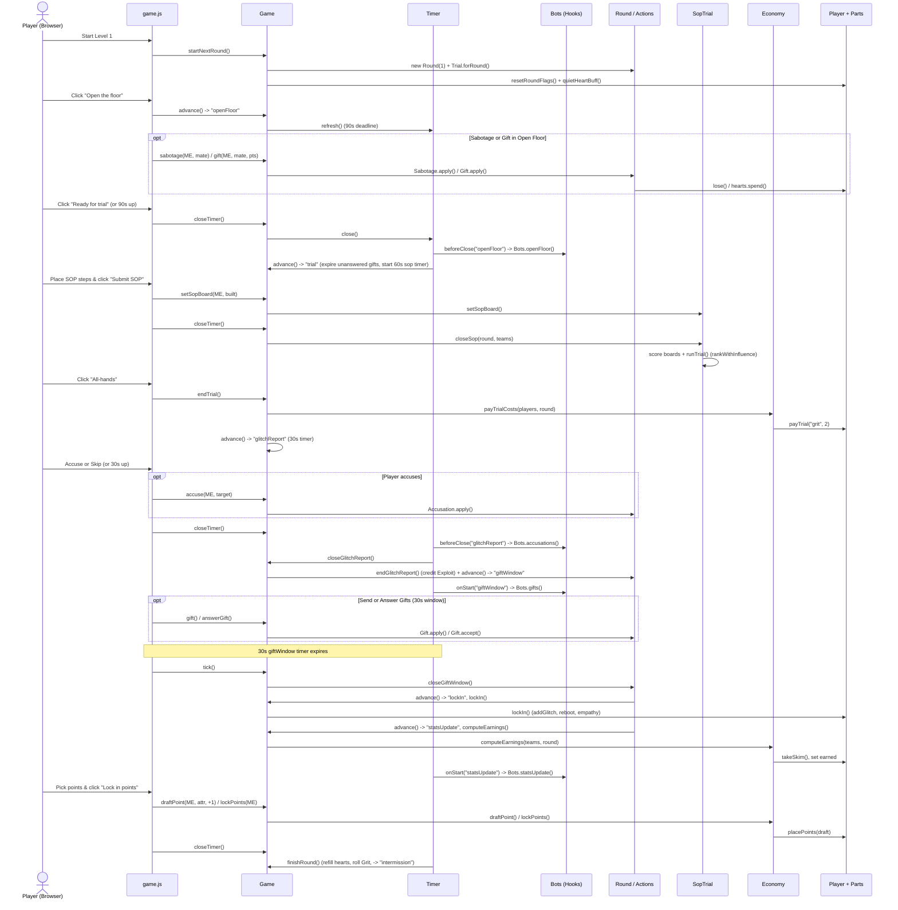

# Exit_ProtocoL OOAD Review (Post-14-Step Refactor)

**Object-Oriented Analysis and Design (OOAD)** is a way of organizing code around "objects" that each own specific data and have one clear job. This review checks the `exit-protocol` codebase after the 14-step refactor.

---

## 1. Summary

The codebase is in strong shape after the 14-step refactor. The rules engine in `rules/` is completely free of browser and screen code, and every class has a clear role.
**Three biggest strengths:**
1. **Clean rules-to-screen boundary:** `rules/*.js` has zero DOM or browser calls, and deterministic save/load (`Game.toJSON` and `Game.fromJSON` in `rules/Game.js:544-582`) works at every step.
2. **True polymorphism on types and trials:** `CharacterType` (`rules/CharacterType.js:11-79`) and `Trial` (`rules/Trial.js:13-337`) replace scattered `if` checks with clean subclasses.
3. **Extracted helper parts:** Splitting `Player` into `Attributes`, `PlayerStatus`, `PathTracker`, and `Wallet` (`rules/Player.js:28-59`), and `Game` into `Timer`, `Economy`, `Attendance`, and `Round` (`rules/Game.js:91-94`), made both core classes much easier to read and test.

**Three biggest risks:**
1. **Screen code is still wired for one local player and Level 1:** `game.js` holds `G`, `ME`, and `MYTEAM` in browser memory (`game.js:76`) and locks after Level 1 (`game.js:143, 372`).
2. **Two-way links and mutable getters in `Player` parts:** `Attributes`, `PlayerStatus`, `PathTracker`, and `Wallet` each hold a back-reference to `Player`, and `Player.draft` (`rules/Wallet.js:21`) still exposes an internal object directly.
3. **Bundler fragility:** `tools/build-rules.js:19, 31` relies on single-line regexes to strip `import` and `export` lines.

### Scorecard (1 to 10)

| Area | Score | Why |
|---|---|---|
| **Encapsulation** | **8/10** | Private `#` fields protect `Hearts` and `Player` parts, though `Wallet.draft` (`rules/Wallet.js:21`) and `Player` round flags (`rules/Player.js:128-140`) are still mutated from outside. |
| **Cohesion** | **8/10** | Almost every class in `rules/` has one clear job, while `game.js` (568 lines) still mixes canvas effects, navigation, cutscenes, and screen rendering. |
| **Coupling** | **8/10** | Removing the `Game` to `Bots` import fixed the main cycle in `rules/`, leaving only controlled two-way links between `Player` and its four private parts. |
| **Inheritance and polymorphism** | **9/10** | `CharacterType` and `Trial` use subclasses cleanly with no `type === "coop"` checks in rule or screen logic. |
| **Testability** | **9/10** | Injected clocks (`rules/Timer.js:6`), seeded RNG (`rules/Rng.js:8`), and 8 fast Node test suites make rule testing fast and repeatable. |
| **Readiness for multiplayer** | **7/10** | The `rules/` engine is ready for a Base44 actor, but `game.js` still calls `G` directly in the browser and lacks a per-player private view helper on `Game`. |
| **Readiness for new levels** | **7/10** | Adding a trial subclass in `rules/` takes only a few lines, but `game.js` still hardcodes Level 1 briefing text (`game.js:294-297`), SOP UI (`game.js:302-308`), and Level 1 end lock (`game.js:372`). |

---

## 2. Class Inventory

A **class** is a blueprint that groups related data and functions together. **Composition** means one object creates and owns another object inside itself. A **dependency** means one class uses or calls another class without owning it.

| Class / Subclass | File | Lines (File / Class) | One Job | Owns (Composition) | Uses (Dependencies) |
|---|---|---|---|---|---|
| `Rng` | `rules/Rng.js` | 26 / 18 | Creates seeded random number functions whose state can be saved and restored. | Seed state `a` inside closure (`rules/Rng.js:9`) | None |
| `Hearts` | `rules/Hearts.js` | 35 / 26 | Tracks a player's heart count (0 to 3) and changes it only through safe methods. | `#n` heart count (`rules/Hearts.js:9`) | None |
| `CharacterType` (base) | `rules/CharacterType.js` | 88 / 41 | Defines default rules and caps for a player's work style. | `key`, `name`, `bonus`, `penalty`, `pathName`, `goal`, `pathEvent` (`rules/CharacterType.js:12-19`) | Subclasses `Cooperative`, `Independent`, `Contrarian` (`rules/CharacterType.js:82`) |
| `Cooperative` (`< CharacterType`) | `rules/CharacterType.js` | 88 / 7 | Configures Cooperative bonuses, Lifeline goal, and Empathy. | Inherited fields (`rules/CharacterType.js:55-56`) | `CharacterType` |
| `Independent` (`< CharacterType`) | `rules/CharacterType.js` | 88 / 10 | Configures Independent bonuses, higher gift cost, gift refusal, Cash Out, and Auditor. | Inherited fields (`rules/CharacterType.js:63-64`) | `CharacterType` |
| `Contrarian` (`< CharacterType`) | `rules/CharacterType.js` | 88 / 8 | Configures Contrarian bonuses, sabotage permission, Skim, and Exploit goal. | Inherited fields (`rules/CharacterType.js:74-75`) | `CharacterType` |
| `Wallet` | `rules/Wallet.js` | 103 / 91 | Manages a player's earned points, point placement draft, Skim count, and Cash Out uses. | `#earned`, `#draft`, `#placedThisRound`, `#skimUsed`, `#cashOutUsed`, `#cashedOutThisRound` (`rules/Wallet.js:10-15`) | `Player` via `#player` (`rules/Wallet.js:9`), `CharacterType`, `Hearts` |
| `PlayerStatus` | `rules/PlayerStatus.js` | 64 / 51 | Tracks glitches, idle state, pending attendance glitches, and public status flags. | `#glitches`, `#idle`, `#attendancePending` (`rules/PlayerStatus.js:11-13`) | `Player` via `#player` (`rules/PlayerStatus.js:10`), `Hearts` |
| `Attributes` | `rules/Attributes.js` | 166 / 136 | Stores a player's 5 attributes and handles ability rolls, point losses, heart cover, gifts, and stat reboots. | `#attrs` object (`rules/Attributes.js:24`) | `Player` via `#player` (`rules/Attributes.js:23`) |
| `PathTracker` | `rules/PathTracker.js` | 78 / 68 | Tracks second-path progress, checks graduation rules, and locks final endings. | `#pathProgress`, `#pathDone`, `#locked` (`rules/PathTracker.js:8-10`) | `Player` via `#player` (`rules/PathTracker.js:7`), `CharacterType` |
| `Player` | `rules/Player.js` | 252 / 214 | Coordinates one intern's parts, hearts, work style, round flags, and attendance timestamps. | `hearts` (`Hearts`), `#attributes` (`Attributes`), `#status` (`PlayerStatus`), `#pathTracker` (`PathTracker`), `#wallet` (`Wallet`), `caughtBy`, round flags, attendance times (`rules/Player.js:29-60`) | `CharacterType`, `Attributes`, `Hearts`, `PathTracker`, `PlayerStatus`, `Wallet` |
| `Team` | `rules/Team.js` | 34 / 27 | Holds a team's member list, round win flag, and total trial wins. | `id`, `name`, `members` array, `won`, `trialWins` (`rules/Team.js:4-9`) | `Player` (`rules/Team.js:12, 15`) |
| `Sabotage` | `rules/Sabotage.js` | 40 / 36 | Checks and applies Contrarian sabotage against a teammate. | None (stateless static class) | `Player`, `Team`, `Round`, ` rng` (`rules/Sabotage.js:5-36`) |
| `Accusation` | `rules/Accusation.js` | 40 / 34 | Checks and applies a player's accusation during the Glitch Report. | None (stateless static class) | `Player`, `Team`, `Round`, `CharacterType`, `rng` (`rules/Accusation.js:6-36`) |
| `Gift` | `rules/Gift.js` | 91 / 76 | Checks, sends, accepts, declines, and expires heart gifts between teammates. | None (stateless static class) | `Player`, `Team`, `Round`, `CharacterType`, `rng` (`rules/Gift.js:14-86`) |
| `Round` | `rules/Round.js` | 112 / 89 | Tracks one level's settings, current step, trial object, action records, and delegates round actions. | `stepIndex`, `trial`, `sabotages`, `accusations`, `gifts`, `completed`, `sopBoards`, `sopResults`, `earnings`, `quietHearts`, `gritBonus`, `done` (`rules/Round.js:28-39`) | `Sabotage`, `Accusation`, `Gift`, `CharacterType`, `Trial` (via callback in `fromJSON`) |
| `Vote` | `rules/Vote.js` | 81 / 71 | Collects ranked player ballots and tallies normalized team scores for judged trials. | `ballots` Map (`rules/Vote.js:15`) | `Team`, `Player`, `rng` (`rules/Vote.js:11-77`) |
| `Trial` (base) | `rules/Trial.js` | 349 / 104 | Ranks teams, marks the top half as winners, and calculates light attribute influence. | `rng`, `ranking` (`rules/Trial.js:15-16`) | `Team`, `Round`, `Player`, subclasses `SopTrial`, `AutoTrial`, `JudgedTrial` |
| `SopTrial` (`< Trial`) | `rules/Trial.js` | 349 / 64 | Manages shared team SOP boards, scores the Level 1 coffee SOP, and ranks teams. | `scores` Map (`rules/Trial.js:120`) | `Trial`, `Round`, `Team`, `Player` |
| `AutoTrial` (`< Trial`) | `rules/Trial.js` | 349 / 3 | Ranks teams in Levels 2 to 4 using a random base score plus light attribute influence. | Inherited fields (`rules/Trial.js:191-193`) | `Trial`, `Round`, `Team` |
| `JudgedTrial` (`< Trial`) | `rules/Trial.js` | 349 / 111 | Runs Levels 5 and 6 prompt selection, 300-char writing submissions, and `Vote` ranking. | `level`, `vote` (`Vote`), `prompt`, `writing`, `submissions` Map (`rules/Trial.js:230-234`) | `Trial`, `Vote`, `Team`, `Player` |
| `Attendance` | `rules/Attendance.js` | 88 / 71 | Runs idle and popup timers for players and detects missed check-ins using an injected clock. | `settings` (`idleMs`, `popupMs`, `maxPerRound`) (`rules/Attendance.js:18`) | `Player` (`rules/Attendance.js:34-84`) |
| `Timer` | `rules/Timer.js` | 67 / 61 | Tracks step timer deadlines on an injected clock and closes expired phases in order. | `running`, `current` (`{ name, key, deadline }`), `at` (`rules/Timer.js:12-14`) | Injected `clock`, `getPhase`, `onStart`, `onClose` callbacks (`rules/Timer.js:6-10`) |
| `Economy` | `rules/Economy.js` | 113 / 102 | Handles trial cost payment, Stats Update point earnings, point drafts, Cash Out, and auto-placement. | None (stateless helper instance) | `Player`, `Team`, `Round` (`rules/Economy.js:10-108`) |
| `Game` | `rules/Game.js` | 619 / 534 | Front-desk coordinator that enforces step order, delegates to rule parts, and saves/loads state. | `attendance` (`Attendance`), `economy` (`Economy`), `_timer` (`Timer`), `round` (`Round`), `log`, `prompts`, `submissions` (`rules/Game.js:87-94`) | `Team`, `Player`, `Round`, `Trial`, `Gift`, `Attendance`, `Economy`, `Timer`, `Rng` |
| `Bots` (module object) | `rules/bots.js` | 184 / 168 | Drives bot decisions in solo mode and simulations using `Game` hooks and public methods. | `SETTINGS`, `SOLO_MIX`, `hooks` (`rules/bots.js:16-17, 35, 160-170`) | `CharacterType`, `Economy`, `Game`, `Gift`, `Player`, `Sabotage`, `Team`, `Trial` |

### Classes with More Than One Job
- **`Player` (`rules/Player.js:28-241`):** Most work was moved into its four private parts, but `Player` still directly owns Contrarian `caughtBy` tracking (`rules/Player.js:57, 120-126`), 9 round flags (`rules/Player.js:128-140`), and 5 raw attendance timestamps (`rules/Player.js:48-52`).
- **`Attributes` (`rules/Attributes.js:22-157`):** Holds the 5 attribute numbers and ability math (`rules/Attributes.js:40-72`), but also contains domain rules for paying trial costs (`payTrial`, lines 91-96), gift target selection (`giftTarget` and `receiveGift`, lines 107-128), and glitch reboot (`reboot`, lines 133-149).
- **`Game` (`rules/Game.js:75-608`):** Acts as the front desk for step order and delegation, but also directly implements the quiet heart buff (`quietHeartBuff`, lines 281-294), Cooperative Empathy heart loss (`empathy`, lines 219-222), Grit end-of-round heart bonus (`finishRound`, lines 529-536), and attendance glitch routing (`attendanceMiss`, lines 209-217).

---

## 3. OOAD Principles

### 3.1 Encapsulation and Information Hiding
**Encapsulation** means bundling data with the methods that work on it, and **information hiding** means keeping internal data private so outside code cannot break rules by changing numbers directly.

**What changed in Step 14 (since `docs/encapsulation-report.md`):**
- `Attributes.attrs` (`rules/Attributes.js:40`) now returns a shallow copy `{ ...this.#attrs }` instead of the live object, and the public `attrs` setter was replaced with an explicit `setAttrsForTest(values)` method (`rules/Attributes.js:41`, `rules/Player.js:85`).
- Unused setters `draft`, `placedThisRound`, `pathProgress`, and `locked` were removed from `Player`, `Wallet`, and `PathTracker` (`rules/Wallet.js:21-22`, `rules/PathTracker.js:14, 17`, `rules/Player.js:214-215, 230, 233`).
- `Game.timer` (`rules/Game.js:112`) now returns `{ ...this._timer.current }` (a copy) or `null`.

**What still matters:**
- `Hearts` (`rules/Hearts.js:8-33`) is the gold standard in this repo: `#n` is private, `.count` is read-only, and only `spend`, `refill`, `refund`, `lose`, and `empty` can change it.
- `Wallet.draft` (`rules/Wallet.js:21`, exposed at `rules/Player.js:214`) still returns the live `#draft` object without copying. `Economy.draftPoint` (`rules/Economy.js:54-55`) mutates `p.draft[k]` and `delete p.draft[k]` directly from outside `Wallet`.
- `Player.earned` (`rules/Player.js:213`), `Player.glitches` (`rules/Player.js:97`), `Player.idle` (`rules/Player.js:99`), `Player.attendancePending` (`rules/Player.js:101`), and `Player.pathDone` (`rules/Player.js:232`) still have public setters. For example, `Economy.computeEarnings` (`rules/Economy.js:33`) and `Game.startNextRound` (`rules/Game.js:270`) assign `p.earned = ...` directly instead of calling a method on `Wallet`.
- `Player` round flags (`sabotagesThisRound`, `wasSabotagedThisRound`, `accusedThisRound`, `correctAccusation`) and attendance fields (`attendancePaused`, `attendancePopupAt`, `attendanceResumeAt`, `attendanceMissAt`, `attendanceMissesThisRound`) are public properties mutated directly by `Sabotage` (`rules/Sabotage.js:30, 33`), `Accusation` (`rules/Accusation.js:24, 27`), and `Attendance` (`rules/Attendance.js:39-46, 70-83`).
- `Trial.run` (`rules/Trial.js:30-31`) and `Vote.tally` (`rules/Vote.js:76`) mutate `team.won` and `team.trialWins` directly on `Team`.
- In browser code, `game.js`, `pixel-art.js`, and `world-map.js` run as top-level scripts without module or IIFE wrappers (`game.js:1-568`, `pixel-art.js:1-162`, `world-map.js:1-262`), whereas `board.js:4`, `attendance-view.js:5`, `fullscreen-view.js:6`, and `pages/vote-test.js:4` properly wrap their internals in IIFEs.

### 3.2 Abstraction
**Abstraction** means giving callers a simple, high-level method that hides complex multi-step work behind the scenes.

- **Closing the gift window:** Screen or timer code calls `G.closeGiftWindow()` (`rules/Game.js:466-473`). Behind that one call, `Game` and `Round` expire unanswered gifts (`rules/Game.js:254`), advance to Lock-in, lock glitches and apply Empathy (`rules/Game.js:452-464`), advance to Stats Update, compute everyone's point earnings (`rules/Economy.js:20-38`), and start the 30-second Stats Update timer (`rules/Game.js:480`).
- **Progress board view:** `board.js:34` calls `getBoard()`, which runs `G.board()` (`rules/Game.js:586-592`). The caller receives ready-to-render player statuses (`p.boardStatus()` from `rules/PlayerStatus.js:41-47`), team wins, and past submissions without knowing how At Risk or Glitching is calculated.
- **Timer catch-up:** `G.tick()` (`rules/Game.js:134`, `rules/Timer.js:33-40`) hides deadline math and phase chaining. When a sleeping game wakes up late in `Game.fromJSON` (`rules/Game.js:580`), `tick()` closes every expired timer in sequence from its exact deadline (`rules/Timer.js:38, 49-56`).

### 3.3 Inheritance and Polymorphism
**Inheritance** lets a child class (subclass) reuse and specialize a parent class (base class). **Polymorphism** means callers can call the same method on different subclasses and each subclass runs its own version without the caller checking which type it is.

- **`CharacterType` and its 3 subclasses (`rules/CharacterType.js:11-79`):**
  - Base class `CharacterType` defines default methods: `giftCost(pts)` returns `pts`, `canAcceptGifts()` returns `true`, `canSabotage()` returns `false`, `hasEmpathy()`, `hasCashOut()`, and `hasSkim()` return `false` (`rules/CharacterType.js:26-35`).
  - `Cooperative` (`rules/CharacterType.js:53-59`) overrides `hasEmpathy() { return true; }`.
  - `Independent` (`rules/CharacterType.js:61-70`) overrides `giftCost`, `giftRefundPerPoint`, `canAcceptGifts`, and `hasCashOut`.
  - `Contrarian` (`rules/CharacterType.js:72-79`) overrides `canSabotage` and `hasSkim`.
  - Callers ask the object: `actor.type.canSabotage()` (`rules/Sabotage.js:11`), `receiver.type.canAcceptGifts()` (`rules/Gift.js:37`), `q.type.hasEmpathy()` (`rules/Game.js:221`), and `T().ct.canSabotage()` (`world-map.js:182, 189`).
- **`Trial` and its 3 subclasses (`rules/Trial.js:13-337`):**
  - Base class `Trial` implements `run(round, teams)` (`rules/Trial.js:25-35`), `rankWithInfluence` (`rules/Trial.js:70-77`), and `sortBy` (`rules/Trial.js:47-53`).
  - Subclasses `SopTrial` (`rules/Trial.js:119-182`), `AutoTrial` (`rules/Trial.js:191-193`), and `JudgedTrial` (`rules/Trial.js:227-337`) each implement `rank(round, teams)` (`rules/Trial.js:175, 192, 326`).
- **Are any type-name or kind checks left?**
  - For `CharacterType`: There are **zero** `type === "coop"` or `type.key === ...` rule branches. `type.key` is used only as a dictionary/pool key or save string in `rules/Player.js:147`, `rules/bots.js:40, 115`, `game.js:34`, and test tally keys (`Tests/check_rules.js:51-53`).
  - For `Trial`: `Trial.forRound` (`rules/Trial.js:83-87`) and `Trial.fromJSON` (`rules/Trial.js:98-112`) check `round.trialKind` and `data.kind` to construct the right subclass, which is normal for a factory method. However, `Game` also uses `instanceof Trial.SopTrial` and `instanceof Trial.JudgedTrial` in `timerName()` (`rules/Game.js:123-124`), `sop()` (`rules/Game.js:327`), `sopBoard()` (`rules/Game.js:342`), `setSopBoard()` (`rules/Game.js:347`), `judged()` (`rules/Game.js:361`), and `typeSubmission()` (`rules/Game.js:378`), and `Bots.trial` checks `instanceof Trial.JudgedTrial` (`rules/bots.js:67`).

### 3.4 Composition and Delegation
**Delegation** means an outer object receives a method call and hands the work off to an inner helper object it owns.

- **`Player` and its parts (`rules/Player.js:28-241`):**
  - `Player` owns `#attributes`, `#status`, `#pathTracker`, `#wallet` (private `#` fields), and `hearts` (public field, `rules/Player.js:46`).
  - Pass-through methods are mostly consistent (`Player.lose` -> `#attributes.lose`, `Player.flag` -> `#status.flag`, `Player.canCashOut` -> `#wallet.canCashOut`, `Player.graduates` -> `#pathTracker.graduates`), with one notable inconsistency: `hearts` is exposed publicly (`player.hearts.spend`, `player.hearts.refill`, `player.hearts.count`), yet `Player` also defines pass-through helpers `heartCount()` and `spendHearts(n)` (`rules/Player.js:81-82`) used only by `Attributes.cover` and `Attributes.payTrial` (`rules/Attributes.js:84-85, 93-95`). Meanwhile, `Wallet.canCashOut` (`rules/Wallet.js:38`) and `PlayerStatus.isAtRisk` (`rules/PlayerStatus.js:30`) reach through `this.#player.hearts` directly.
- **`Game` with `Timer`, `Economy`, `Attendance`, and `Round` (`rules/Game.js:81-96`):**
  - `Game` checks step rules first (`wrongStep`, `mustBe`, `once`) and then delegates:
    - Round actions (`sabotage`, `gift`, `answerGift`, `accuse`, `endGlitchReport`, `closeGlitchReport`, `closeGiftWindow`) go to `this.round` (`rules/Game.js:300, 421, 426, 433, 441, 448, 468`).
    - Point and cost methods (`payTrialCosts`, `computeEarnings`, `placingWhy`, `draftPoint`, `lockPoints`, `cashOut`, `autoPlacePoints`, `placeAllRemaining`) go to `this.economy` (`rules/Game.js:152, 408, 479, 486, 495, 502, 510, 520`).
    - Timer methods (`now`, `start`, `refreshTimer`, `secondsLeft`, `tick`, `closeTimer`, `closeTimerAt`) go to `this._timer` (`rules/Game.js:114-136`).

### 3.5 Cohesion
**Cohesion** measures how focused a class is: a high-cohesion class does one job, while a low-cohesion class mixes unrelated jobs.

- **High cohesion:** `Hearts` (`rules/Hearts.js`), `Rng` (`rules/Rng.js`), `Timer` (`rules/Timer.js`), `Vote` (`rules/Vote.js`), `Team` (`rules/Team.js`), `CharacterType` (`rules/CharacterType.js`), `PlayerStatus` (`rules/PlayerStatus.js`), `PathTracker` (`rules/PathTracker.js`), `Sabotage` (`rules/Sabotage.js`), `Accusation` (`rules/Accusation.js`), `Gift` (`rules/Gift.js`), `board.js`, `attendance-view.js`, and `fullscreen-view.js` each do one well-defined job.
- **Classes/files that drift:**
  - **`game.js` (568 lines):** Combines matrix code-rain canvas rendering (`game.js:1-24`), static lore and clue tables (`game.js:26-60`), localStorage name persistence (`game.js:92-96`), step navigation (`game.js:131-167`), HUD/topbar chrome (`game.js:170-193`), 10 screen HTML templates `V[0]` to `V[9]` (`game.js:198-372`), the elevator visual-novel cutscene (`game.js:375-440`), DOM event binding (`game.js:457-516`), and custom SVG cursor styling (`game.js:548-553`).
  - **`world-map.js` (262 lines):** Mixes two separate maps: the static 800x560 office preview map (`world-map.js:9-65`) and the interactive 2300x1420 walkable Floor 60 map with physics, joystick input, ghost timers, and room action panels (`world-map.js:68-262`).
  - **`Round` (`rules/Round.js:22-110`):** Tracks step order and round action records, but also acts as a storage bag for Level 1 `sopBoards` and `sopResults` (`rules/Round.js:34-35`), `Economy` `earnings` (`rules/Round.js:36`), and `Game` `quietHearts` and `gritBonus` (`rules/Round.js:37-38`).

### 3.6 Coupling
**Coupling** measures how tightly classes are connected to each other. Loose coupling means you can change one class without breaking others; a **circular or two-way link** means two objects hold references to each other.

**Circular and Two-Way Links in the Codebase:**

| Link | Where | Rating | Explanation |
|---|---|---|---|
| `Player` <-> `Attributes` | `rules/Player.js:45` (`this.#attributes = new Attributes(this, spend)`) and `rules/Attributes.js:23, 27` (`this.#player = player`) | **Medium** | `Attributes` calls `this.#player.isBonus(k)`, `max(k)`, `heartCount()`, `spendHearts()`, `isStuck()`, and `isGlitching()`. Safe because `#attributes` is private to `Player`, and `toJSON()` breaks the cycle. |
| `Player` <-> `PlayerStatus` | `rules/Player.js:47` (`this.#status = new PlayerStatus(this)`) and `rules/PlayerStatus.js:10, 15` (`this.#player = player`) | **Low** | `PlayerStatus` only reads `this.#player.attr(k)`, `this.#player.hearts.count`, and `this.#player.rate(k)` (`rules/PlayerStatus.js:27, 30`). Never mutates `Player`. |
| `Player` <-> `PathTracker` | `rules/Player.js:54` (`this.#pathTracker = new PathTracker(this)`) and `rules/PathTracker.js:7, 12` (`this.#player = player`) | **Low** | `PathTracker` only reads `this.#player.type`, `total()`, `lowest()`, `glitches`, `isStuck()`, and `idle` (`rules/PathTracker.js:22, 32-38, 50`). Never mutates `Player`. |
| `Player` <-> `Wallet` | `rules/Player.js:58` (`this.#wallet = new Wallet(this)`) and `rules/Wallet.js:9, 17` (`this.#player = player`) | **Medium** | `Wallet` reads player state and mutates `this.#player.hearts.spend(...)` (`rules/Wallet.js:42`) and `this.#player.addAttr(...)` (`rules/Wallet.js:67`). |
| `Game` <-> `Timer` (via closures) | `rules/Game.js:94, 98-109` (`this._timer = new Timer({ getPhase: () => ..., onStart: ..., onClose: ... })`) | **Low** | `Timer` does not import `Game`; it receives callbacks from `Game._makeTimer`. This is clean dependency injection. |
| `Team` <-> `Player` (by ID) | `rules/Team.js:12` (`this.members.push(p)` and `p.teamId = this.id`) | **Low** | `Team` holds `Player` references, while `Player` only stores the primitive `teamId` string/number (not a `Team` object reference). |
| `game.js` <-> `world-map.js` <-> `pixel-art.js` (global scope) | `game.js:212, 215, 283, 452` calls `dialogsHTML`, `minimapSVG`, `worldHTML`, `fitWorld`, `initWorld`; `world-map.js:60, 180-189, 255` reads/calls `S`, `G`, `ME`, `MYTEAM`, `TEAM`, `avatarSVG`, `render`, `BOARD`; `pixel-art.js:156` reads `S.av` | **High** | The three browser script files share mutable global variables (`S`, `G`, `ME`, `W`, `DPOS`) with no explicit imports or interfaces. |

---

## 4. SOLID Check

**SOLID** is a set of five classic object-oriented design rules that keep software easy to maintain and extend.

### S: Single Responsibility Principle (Pass / Partial)
*A class should have only one reason to change.*
- **Verdict: Partial (Pass in most of `rules/`, Fail in `game.js`).**
- **Evidence:** `Hearts` (`rules/Hearts.js:8-33`), `Timer` (`rules/Timer.js:5-65`), `Vote` (`rules/Vote.js:9-79`), and `PathTracker` (`rules/PathTracker.js:6-73`) each have a single responsibility. By contrast, `game.js` (`game.js:1-568`) handles visual effects, localStorage, routing, HTML templates for 10 screens, and game controller actions all in one file.

### O: Open/Closed Principle (Pass)
*Classes should be open for extension (adding new behavior via subclasses) without modifying existing caller code.*
- **Verdict: Pass.**
- **Evidence:** Adding a fourth `CharacterType` subclass in `rules/CharacterType.js` requires zero changes to `Sabotage`, `Accusation`, `Gift`, `Wallet`, or `PathTracker`, because they call polymorphic methods (`canSabotage()`, `giftCost()`, `pathCounts(event)`). Similarly, `Trial.run(round, teams)` (`rules/Trial.js:25-35`) ranks any `Trial` subclass that implements `rank(round, teams)`.

### L: Liskov Substitution Principle (Partial)
*Any subclass object should be usable wherever its base class is expected without surprising callers.*
- **Verdict: Partial.**
- **Evidence:** Every `CharacterType` subclass (`Cooperative`, `Independent`, `Contrarian` in `rules/CharacterType.js:53-79`) is 100% substitutable for `CharacterType`. For `Trial` (`rules/Trial.js:13-337`), `SopTrial`, `AutoTrial`, and `JudgedTrial` all honor `trial.run(round, teams)` and `trial.toJSON()`. However, `JudgedTrial.rank(round, teams)` (`rules/Trial.js:326-329`) throws `"Writing has not started (startWriting)."` (`rules/Trial.js:319`) unless the caller first ran the multi-step `startWriting() -> closeWriting()` sequence, whereas `AutoTrial.rank` and `SopTrial.rank` can run immediately (`rules/bots.js:67-73`).

### I: Interface Segregation Principle (Partial)
*Callers should not be forced to depend on large interfaces with methods they do not use.*
- **Verdict: Partial.**
- **Evidence:** Small view modules follow this well: `BoardView.mount(getBoard)` (`board.js:25`) only asks for a function returning `Game.board()`, and `FullscreenView.mount(btn)` (`fullscreen-view.js:22`) only takes a DOM button. On the other hand, `Player` (`rules/Player.js:28-241`) exposes 55+ getters, setters, and methods on one class, and `Game` (`rules/Game.js:75-608`) exposes level-specific methods (`setSopScore`, `scoreSop`, `sopBoard`, `setSopBoard`, `closeSop`, `setPrompt`, `startWriting`, `typeSubmission`, `submit`, `closeWriting`, `startVote`, lines 325-396) alongside general round methods.

### D: Dependency Inversion Principle (Pass)
*High-level rule classes should depend on abstractions (like injected functions or interfaces), not hardcoded low-level details (like system clocks, `Math.random`, or bot scripts).*
- **Verdict: Pass.**
- **Evidence:** `Game` (`rules/Game.js:81`) and `Timer` (`rules/Timer.js:6`) accept an injected `clock` function instead of hardcoding `Date.now()`, an injected `rng` function (`Rng.seeded` in `rules/Rng.js:8`), and an optional `hooks` object (`{ onStart, beforeClose }`). `Game` no longer imports `bots.js`; instead, solo games pass `hooks: EP.Bots.hooks` (`game.js:81`, `Tests/check_save.js:33`). Also, `Round.fromJSON` (`rules/Round.js:95`) accepts a `trialFromJSON` callback so `Round` does not depend on `Trial`.

---

## 5. Design Patterns in Use

A **design pattern** is a proven, reusable solution to a common software design problem.

### Patterns Present in the Codebase

| Pattern | One-Sentence Explanation | Where It Lives | Used Well? |
|---|---|---|---|
| **Facade** | Provides a single, simplified front-desk interface in front of a group of smaller classes. | `Game` (`rules/Game.js:75-608`) wraps `Round`, `Trial`, `Timer`, `Economy`, and `Attendance`; `Player` (`rules/Player.js:28-241`) wraps `Attributes`, `PlayerStatus`, `PathTracker`, `Wallet`, and `Hearts`. | **Yes.** Screen code and tests talk to `Game` and `Player` without managing their internal parts directly. |
| **Template Method** | A base class defines the fixed steps of an algorithm and lets subclasses fill in specific steps. | `Trial.run(round, teams)` (`rules/Trial.js:25-35`) calls `this.rank(round, teams)`, computes `Trial.winners(order.length)`, sets `team.won` and `team.trialWins`, and formats the ranking; subclasses override `rank()` (`rules/Trial.js:175, 192, 326`). | **Yes.** Eliminates duplicate winner-marking logic across all three trial types. |
| **Strategy / Polymorphic State** | Encapsulates interchangeable rule variations as separate objects that share the same interface. | `CharacterType` and its singleton subclasses `Cooperative`, `Independent`, `Contrarian` (`rules/CharacterType.js:11-82`). Also functions as **Flyweight** (shared stateless instances in `ALL`, line 82). | **Yes.** Completely removed `if (type === ...)` branches across the codebase. |
| **Simple Factory** | A static method creates and returns the right subclass instance based on input data. | `Trial.forRound(round, rng)` (`rules/Trial.js:83-87`), `Trial.fromJSON(data, ...)` (`rules/Trial.js:95-115`), and `CharacterType.get(key)` (`rules/CharacterType.js:44-49`). | **Yes.** Keeps subclass creation in one place. |
| **Observer / Lifecycle Hooks** | Lets external listeners react to events (like timer starts and closes) without the core class knowing who is listening. | `Game.hooks` (`onStart`, `beforeClose` in `rules/Game.js:81, 103-105`) and `Bots.hooks` (`rules/bots.js:160-170`). | **Yes.** Broke the circular dependency between `Game` and `Bots` while keeping bot timing identical. |
| **Memento (Serialization)** | Captures an object's complete internal state as plain data so it can be saved and restored later. | `toJSON()` and `fromJSON()` on `Game` (`rules/Game.js:544-582`), `Player` (`rules/Player.js:144-173`), `Attributes`, `PlayerStatus`, `PathTracker`, `Wallet`, `Team`, `Round`, `Trial`, and `Timer`, plus `rng.getState()` / `setState()` (`rules/Rng.js:16-17`). | **Yes.** Tested across 20 full games (about 3,500 saves) in `Tests/check_save.js:156-196`. |

### Patterns That Would Clearly Help Next
1. **Command / Message Envelope (for Base44 Multiplayer):**
   - *What it is:* Turns every player action into a plain data object (like `{ type: "sabotage", targetId: 3 }`) handled by one dispatcher method.
   - *Where it helps:* Adding a `Game.dispatch(playerId, action)` method on `Game` (`rules/Game.js`) will let the Base44 WebSocket actor validate the sender, look up `Player` and `Team` objects by ID, run the action, and save state in one place instead of writing 15 separate WebSocket handlers.
2. **Data Transfer Object / Projection View (for Base44 Multiplayer):**
   - *What it is:* A method that builds a filtered, plain-data snapshot containing only what one specific recipient is allowed to see.
   - *Where it helps:* `Game.board()` (`rules/Game.js:586-592`) already builds the public board DTO. Adding `Game.playerView(playerId)` on `Game` will package that player's own attributes, hearts, type, pending gifts, and step state while stripping hidden types and stats of all other players before sending over WebSockets.

---

## 6. Data Flow: One Full Round (Level 1)

### Step-by-Step Walkthrough (Briefing to Stats Update)

1. **Start Round 1 (`Briefing`):** `game.js:97` calls `G.startNextRound()` (or closes the initial `intermission` timer at `rules/Game.js:139`). `Game.startNextRound()` (`rules/Game.js:261-276`) increments `level` to `1`, creates `new Round(1)` (`rules/Round.js:23`), attaches `new SopTrial(this.rng)` via `Trial.forRound` (`rules/Trial.js:84`), calls `p.resetRoundFlags()` (`rules/Player.js:128`) and `t.resetRound()` (`rules/Team.js:18`), runs `quietHeartBuff()` (`rules/Game.js:281`), and pauses `Attendance` (`rules/Game.js:273`).
2. **Enter `Open Floor`:** Clicking "Open the floor" in `game.js:154` calls `G.advance()` (`rules/Game.js:248-259`). `Round.nextStep()` moves to `"openFloor"`, `Game.syncAttendance()` resumes the 60-second `Attendance` clock (`rules/Attendance.js:43`), and `Timer.refresh()` starts the 90-second `openFloor` deadline (`rules/Timer.js:27`).
3. **Open Floor Player Actions:** On the walkable map (`world-map.js:180-184`, `game.js:495-496`), the player may call `G.sabotage(ME, target)` (`rules/Game.js:297` -> `Round.sabotage` -> `Sabotage.apply` in `rules/Sabotage.js:25`, which spends hearts, rolls Composure on `target`, calls `target.lose(round.attr, drain)` on `Attributes`, and logs to `round.sabotages`) or `G.gift(ME, receiver, pts)` (`rules/Game.js:437` -> `Round.gift` -> `Gift.apply` in `rules/Gift.js:32`).
4. **Close `Open Floor` and Enter `Trial`:** When the 90-second timer expires or the player clicks "Ready for trial" (`game.js:155, 526`), `G.closeTimer()` runs `Timer.closeAt()` (`rules/Timer.js:49`). First, `Bots.hooks.beforeClose` runs `Bots.openFloor(G, G.rng)` (`rules/bots.js:162`, where Contrarian bots sabotage). Next, `Game._closeTimerPhase("openFloor")` calls `G.advance()` (`rules/Game.js:140`), which expires unanswered Open Floor gifts via `Gift.expireAll` (`rules/Game.js:254`), advances `Round` to `"trial"`, and starts the 60-second `"sop"` timer (`rules/Game.js:123`).
5. **Edit Shared SOP Board:** Each card click in `game.js:500-502` calls `G.setSopBoard(ME, built)` (`rules/Game.js:346` -> `SopTrial.setSopBoard` in `rules/Trial.js:149`), validating the steps and saving a copy on `round.sopBoards[team.id]`.
6. **Score SOP and Rank Teams:** Clicking "Submit SOP" (`game.js:531`) or letting the 60-second timer expire calls `G.closeTimer()`, which invokes `Game.closeSop()` (`rules/Game.js:354`) -> `SopTrial.closeSop(round, teams)` (`rules/Trial.js:163`). `SopTrial` scores human teams' boards with `SopTrial.score`, calls `Trial.runTrial` -> `Trial.run` (`rules/Trial.js:25-35`), assigns random base scores (0 to 7) to bot teams (`rules/Trial.js:176`), adds light attribute influence (`Trial.influence` at `rules/Trial.js:58`), sorts teams, and sets `team.won` and `team.trialWins` for the top half.
7. **Pay Trial Costs and Enter `Glitch Report`:** Clicking "All-hands" (`game.js:156, 535`) calls `G.endTrial()` (`rules/Game.js:411`). `Game.payTrialCosts()` (`rules/Game.js:404`) delegates to `Economy.payTrialCosts` (`rules/Economy.js:10`), which calls `p.payTrial("grit", 2)` -> `Attributes.payTrial` (`rules/Attributes.js:91`) -> `Attributes.lose` and `Attributes.cover` (spending `Hearts` if Grit drops below 0). Then `G.advance()` moves `Round` to `"glitchReport"`, pauses `Attendance`, and starts the 30-second `"glitchReport"` timer (`rules/Game.js:127`).
8. **Accusations and Close `Glitch Report`:** The player accuses (`G.accuse` -> `Round.accuse` -> `Accusation.apply` in `rules/Accusation.js:21`, crediting `PathTracker` for Auditor on a hit or calling `Attributes.takeFromHighest(1)` unless saved by Focus roll) or skips (`game.js:505-506`), which calls `G.closeTimer()`. `Bots.hooks.beforeClose` runs `Bots.accusations` (`rules/bots.js:163`), and `Game.closeGlitchReport()` (`rules/Game.js:430`) -> `Round.closeGlitchReport` (`rules/Round.js:67`) credits uncaught saboteurs with Exploit (`Round.endGlitchReport`, line 63) and advances `Round` to `"giftWindow"`.
9. **Gift Window (30 seconds):** Entering `"giftWindow"` resumes `Attendance`, starts the 30-second `"giftWindow"` timer, and fires `Bots.hooks.onStart` -> `Bots.gifts(G, G.rng)` (`rules/bots.js:166`), where bots send rescue gifts to Glitching teammates. Human players can send or answer gifts via `G.gift` and `G.answerGift` (`rules/Game.js:437, 444` -> `Gift.accept` / `Gift.decline` in `rules/Gift.js:56, 75`, crediting Lifeline if a glitch is cancelled).
10. **Close Gift Window, `Lock-in`, and Compute Earnings:** When the 30-second gift window timer expires (`rules/Game.js:144`), `Game.closeGiftWindow()` (`rules/Game.js:466`) calls `Round.closeGiftWindow` (`rules/Round.js:72`). That expires unanswered gifts, advances to `"lockIn"`, runs `Game.lockIn()` (`rules/Game.js:452` -> `Player.lockIn()` at `rules/Player.js:185`, which increments glitches on `PlayerStatus`, reboots attributes on `Attributes` and empties `Hearts`, and triggers `Game.empathy()` heart loss on Cooperative teammates), advances to `"statsUpdate"`, and runs `Game.computeEarnings()` (`rules/Game.js:476` -> `Economy.computeEarnings` at `rules/Economy.js:20`, setting `p.earned` and `round.earnings`).
11. **Stats Update and Finish Round:** `Timer.refresh()` starts the 30-second `"statsUpdate"` timer and triggers `Bots.hooks.onStart` -> `Bots.statsUpdate(G)` (`rules/bots.js:167`), so bots Cash Out and place their points. The human player picks draft points with `G.draftPoint(ME, k, delta)` (`rules/Economy.js:48`), optionally calls `G.cashOut(ME)` (`rules/Economy.js:67`), and clicks "Lock in points" (`game.js:525`) or lets the 30-second timer expire (`rules/Game.js:145`). `Economy.lockPoints` or `Economy.placeAllRemaining` calls `Wallet.placePoints` (`rules/Wallet.js:59`), and `Game.finishRound()` (`rules/Game.js:522-539`) refills 1 heart per non-Stuck player, rolls Grit for +1 bonus heart, marks `"finishRound"` complete, and returns the game to `"intermission"`.

### Mermaid Sequence Diagram (Level 1 Round)

---

## 7. Readiness for New Levels (Levels 2 to 7)

### What a Developer Must Add or Change for a New Level and Trial Type
1. **In `rules/Trial.js`:**
   - Create a new subclass of `Trial` (or replace `AutoTrial` for Levels 2 to 4) that implements `rank(round, teams)` returning `[{ team, ...details }]` best first (for example, using `this.rankWithInfluence(round, teams, team => baseScore)` like `SopTrial` at `rules/Trial.js:175-178`).
   - Add `get kind()` and override `toJSON()` on the subclass (`rules/Trial.js:180-181`), and add a branch in `Trial.forRound(round, rng)` (`rules/Trial.js:83-87`) and `Trial.fromJSON(data, ...)` (`rules/Trial.js:95-115`).
2. **In `rules/Round.js`:**
   - Update `trialKind` in `LEVELS` (`rules/Round.js:8-16`) for that level if it uses a new trial subclass instead of `"auto"`.
3. **In `rules/Game.js`:**
   - If the new trial has a timed interactive phase (like `"sop"` or `"writing"`), add its duration to `TIMER_SECONDS` (`rules/Game.js:69-73`), return its phase name in `timerName()` (`rules/Game.js:121-126`), and handle its timer close in `_closeTimerPhase(name)` (`rules/Game.js:137-148`).
   - Add pass-through methods on `Game` for player actions in that trial (similar to `setSopBoard` / `closeSop` at `rules/Game.js:346-358`).
4. **In `rules/bots.js`:**
   - Update `Bots.trial(game, rng)` (`rules/bots.js:66-74`) if bot teams need to submit scores or answers during the new trial.
5. **In `game.js`:**
   - Update `V[5]` (Briefing, `game.js:294-297`) and `V[7]` (Trial screen, `game.js:302-308`) to render the current level's briefing memo and trial UI instead of Level 1's SOP UI, and update `V[9]` (`game.js:360-372`) and `fwd()` (`game.js:143`) so completing a level advances to the next level instead of locking after Level 1.

### Everything Still Hardcoded to Level 1 (Rules and Screens)

- **`rules/`:**
  - Almost nothing in `rules/` is hardcoded to Level 1. The only special case is `Game.timerName()` (`rules/Game.js:119`): `if (s === "intermission") return this.level === 0 ? "intermission" : null;`, which is an intentional rule decision documented in `CLAUDE.md:349` (only the first intermission before Level 1 is timed).
- **Screen code (`game.js` and `world-map.js`):**
  - `game.js:54-59`: `FAC` host script array has only 10 entries corresponding to the onboarding steps and Level 1 ("Intermission in All Skate... start Level 1", "Reveal: Boot Up tests Grit. Every player pays 2 Grit", "Teams play the SOP challenge (coffee)").
  - `game.js:98`: `const R=()=>G&&G.round?G.round:new EP.Round(1);` falls back to Level 1 when no round is active.
  - `game.js:138`: `fwd()` at step 4 hardcodes the button label `"Start Level 1 ▶"`.
  - `game.js:143`: `fwd()` at step 9 disables the forward button once the round finishes (`ok: !roundDone() && placeLeft() === 0`) and shows `"Level 2 locked"`, preventing navigation to Level 2.
  - `game.js:233`: The onboarding packet table hides trial costs for Levels 2 to 6 (`r.n===1?r.c:r.c?"?":"0"`).
  - `game.js:294-297`: `V[5]` (Briefing view) hardcodes `"System Briefing · Level 1"`, `"Boot Up: Team Week"`, the Medline RFP memo, and `"Weeks 1-2: Team Week, teams formed, Medline RFP, SOP challenge"`.
  - `game.js:302-308` and `game.js:498-503, 530-534`: `V[7]` (Trial view) and its event bindings in `bind()` only render and bind the Level 1 coffee SOP mini-game (`G.sopBoard`, `SOP`, `DECOY`, `checkSop`). Levels 5 and 6 live in a separate test page (`pages/vote-test.js:1-222`) and are not wired into `game.js`.
  - `game.js:372` and `game.js:513`: `V[9]` (Stats Update view) hardcodes `LOCKED` for the next level and shows `<button class="btn blue" id="replay">Replay Level 1</button>`.
  - `world-map.js:80, 146, 165`: `LOCKS` draws red locked barriers at `"ACCESS · LVL 3"` and `"LVL 4"`, but they are visual labels only and never unlock based on `G.level`.
  - `world-map.js:185`: High Tea guest dialogue hardcodes the Level 1 SOP hint (`"When I wrote my first SOP, I put in a step that never ended..."`).

---

## 8. Readiness for Multiplayer on a Base44 Actor

### What Already Fits the Base44 Plan
1. **Zero DOM in `rules/`:** Every file in `rules/*.js` is pure JavaScript ES modules (`rules/index.js:1-24`) that can run directly inside a Base44 backend actor.
2. **Complete State Serialization (`Game.toJSON` / `Game.fromJSON`):** `Game.toJSON()` (`rules/Game.js:544-561`) serializes the entire game into plain JSON with IDs instead of object references, and `Game.fromJSON()` (`rules/Game.js:564-582`) restores it and immediately catches up any passed deadlines via `g.tick()`.
3. **Seeded, Saveable RNG (`Rng`):** `Rng.seeded(seed)` (`rules/Rng.js:8-19`) exposes `getState()` and `setState()` so the actor's random sequence survives sleep/wake cycles (`rules/Game.js:558, 569-570`).
4. **Deadline-Based Timers on an Injected Clock (`Timer`):** `Timer` (`rules/Timer.js:5-65`) stores `deadline` timestamps (`this.now() + this.durations[name] * 1000`), which maps directly to Base44 actor scheduled wakes (`this._timer.current.deadline`).
5. **Decoupled Bot Hooks:** Because bots attach via `hooks` (`rules/Game.js:81`), a real multiplayer actor can omit `Bots.hooks` (or only run bot helpers for bot-filled slots).
6. **Public Safe View (`Game.board()`):** `Game.board()` (`rules/Game.js:586-592`) returns a safe public summary with no hidden types, attributes, hearts, or secret path progress.

### What Blocks Multiplayer or Needs Change
1. **Browser owns `G` and calls rule methods directly:** In `game.js:76-82`, the browser creates `G = new EP.Game(...)` and mutates it directly (`G.advance()`, `G.sabotage()`, `G.accuse()`, `G.draftPoint()`). In multiplayer, `G` must live only in the Base44 actor, and `game.js` must send WebSocket messages and render state pushed from the actor.
2. **No per-player private state projection on `Game`:** `Game.toJSON()` (`rules/Game.js:544-561`) contains every player's secret `type`, `attrs`, `hearts`, `caughtBy`, `pathProgress`, and `round.sabotages` (with `actor` IDs). Sending `Game.toJSON()` to clients would leak every secret. The actor needs a `Game.playerView(playerId)` method that returns:
   - `this.board()` (public to all),
   - That player's own `Player` state (`attrs`, `hearts`, `type`, `glitches`, `earned`, `draft`, `pathProgress`, `abilityLines()`),
   - Teammates' public flags (`p.flag()`),
   - Filtered round records for that player (for example, `drainOn(p)` victim notice without `s.actor`, incoming/outgoing gifts for `p`, and caught notices `caughtOn(team, p)` only after `endGlitchReport`),
   - Current step, level info (hiding future trial attributes until briefing), and `timer` deadline.
3. **Single-player step advancement in `game.js`:** In `game.js:154-157`, one player clicking `"Open the floor ▶"`, `"Ready for trial ▶"`, or `"All-hands ▶"` immediately calls `G.advance()`, `G.closeTimer()`, or `G.endTrial()` for the whole game. In multiplayer, step transitions must be driven by actor timer deadlines, host controls, or "all active players ready/submitted" checks (like `JudgedTrial.allSubmitted` at `rules/Trial.js:314`).
4. **Hardcoded single-team roster and avatars in `game.js` and `world-map.js`:** `game.js:38-39` hardcodes `TEAM` (`Juno`, `Dex`, `Mara`) and `OTHERS`, and `game.js:342` and `world-map.js:150, 184` look up teammate avatars with `TEAM.find(x => x.n === q.name).av`. If a human teammate has a custom name or switches teams (`Game.switchTeam`), `TEAM.find(...)` returns `undefined` and crashes on `.av`. Avatar data (`av`) should be stored on each player record or in actor metadata.
5. **SOP Trial bot-team check (`SopTrial.closeSop`):** `rules/Trial.js:166` checks `if (!t.members.some(p => !p.isBot)) continue;` so teams with at least one human player score their actual board while bot-only teams get a random score. This works for both solo and all-human multiplayer (where `!p.isBot` is true for everyone), as long as human players have `isBot: false`.
6. **Server-side Attendance ticks:** As noted in `CLAUDE.md:339`, a closed browser tab never calls `checkAttendance()`. The Base44 actor must run `G.checkAttendance(Date.now())` on its wake schedule for all connected/disconnected human players, and clients should only send throttled `activity` pings.

### Actor Message Mapping (Player <-> Base44 Actor)

| Direction | Message / Event Name | Maps to `Game` / Rule Method | Payload | Who Receives / Notes |
|---|---|---|---|---|
| **Player -> Actor** | `join` / `createCharacter` | `new Player(...)`, `Team.add(p)` (`rules/Player.js:36`, `rules/Team.js:12`) | `{ name, av, type, spend }` | Validated against `@icstars.org` email and join code; actor assigns `player.id`. |
| **Player -> Actor** | `activity` | `G.activity(player, now)` (`rules/Game.js:176`) | `{}` (throttled ~1s on client) | Resets player's idle/attendance clock on actor. |
| **Player -> Actor** | `sabotage` | `G.sabotage(player, target)` (`rules/Game.js:297`) | `{ targetId }` | Actor returns `{ ok, reason }` to sender; victim gets private drain alert at Trial. |
| **Player -> Actor** | `gift` | `G.gift(player, receiver, pts)` (`rules/Game.js:437`) | `{ receiverId, pts }` | Actor notifies `receiver` of pending gift (or auto-declines if Independent without revealing type). |
| **Player -> Actor** | `answerGift` | `G.answerGift(gift, accept)` (`rules/Game.js:444`) | `{ giftIndex, accept }` | Actor verifies `gift.receiver === player`, updates hearts/attrs, notifies giver and receiver. |
| **Player -> Actor** | `switchTeam` | `G.switchTeam(player, toTeam)` (`rules/Game.js:306`) | `{ teamId }` | Open Floor only; broadcasts updated team rosters. |
| **Player -> Actor** | `setSopBoard` | `G.setSopBoard(player, built)` (`rules/Game.js:346`) | `{ built }` | Level 1 Trial; broadcasts updated `sopBoard` to `player`'s teammates. |
| **Player -> Actor** | `setPrompt` (host only) | `G.setPrompt(choice)` (`rules/Game.js:366`) | `{ choice }` | Levels 5-6; actor verifies sender is host. |
| **Player -> Actor** | `typeSubmission` | `G.typeSubmission(player, text, now)` (`rules/Game.js:376`) | `{ length }` or `{ text }` | Counts as activity and validates length. |
| **Player -> Actor** | `submit` | `G.submit(player, text, now)` (`rules/Game.js:383`) | `{ text }` | Levels 5-6 writing; closes writing early if `allSubmitted`. |
| **Player -> Actor** | `castVote` | `G.round.trial.vote.cast(player, ranking)` (`rules/Vote.js:44`) | `{ rankedPlayerIds }` | Levels 5-6 vote; actor resolves IDs to `Player` objects. |
| **Player -> Actor** | `accuse` | `G.accuse(player, target)` (`rules/Game.js:418`) | `{ targetId }` (or `null` for skip) | Glitch Report; actor stores accusation until window closes. |
| **Player -> Actor** | `draftPoint` | `G.draftPoint(player, attr, delta)` (`rules/Game.js:493`) | `{ attr, delta }` | Stats Update / Graduation; updates player's private draft. |
| **Player -> Actor** | `lockPoints` | `G.lockPoints(player)` (`rules/Game.js:499`) | `{}` | Commits player's draft points. |
| **Player -> Actor** | `cashOut` | `G.cashOut(player)` (`rules/Game.js:505`) | `{}` | Independent only; trades 2 hearts for +1 earned point. |
| **Actor -> Players** | `stateSync` (per-player) | Proposed `G.playerView(p.id)` + `G.board()` (`rules/Game.js:586`) | Private player view + public board + timer deadline | Sent on connect, after each step change, and after actions affecting that player. |
| **Actor -> Team** | `sopBoardUpdate` | `G.sopBoard(team)` (`rules/Game.js:341`) | `{ teamId, built }` | Sent to members of `team` when any teammate edits the shared SOP board. |
| **Actor -> Player** | `attendanceAlert` | `G.checkAttendance(now)` (`rules/Game.js:180`) | `{ state: "popup" \| "missed", msLeft, pending, locked, stuck }` | Sent privately to any player whose attendance state is `"popup"` or `"missed"`. |
| **Actor -> All** | `gameOver` | `G.results()` (`rules/Game.js:596`) | `[{ id, name, ending, wins }]` | Broadcast when Level 7 Graduation finishes. |

---

## 9. Test Design

### Coverage of the 8 Baseline Suites + Screen Suite

| Test File | What It Covers | What It Misses / Notes |
|---|---|---|
| `Tests/check_bundle.js` (51 lines) | Verifies `rules/rules.bundle.js` matches `tools/build-rules.js` output, loads in a clean VM context, and exports identical static constants and prototype methods as `rules/index.js`. | Thorough for build integrity. |
| `Tests/check_rules.js` (66 lines) | Runs 1,000 seeded 16-player bot games through all 7 levels and checks overall graduation %, Stuck %, and win/graduation/path % by type. | Smoke test for fixed 8/5/3 type mix. |
| `Tests/check_gifts.js` (175 lines) | Unit tests `Gift` and `Game.gift` / `answerGift`: accept, decline, expiration in Open Floor and Gift Window, tie-breaking, Glitching target, maxed attribute overflow refund, Independent auto-refusal, Stuck blocks, and 80% seeded bot acceptance. | Thorough unit coverage of gift rules. |
| `Tests/check_steps.js` (1,165 lines) | Comprehensive rule and state-machine test: step order enforcement, `SopTrial`/`AutoTrial`/`JudgedTrial` ranking and ties, caught Contrarian rules, wrong accusation ties, all 5 stat abilities, team switching, vote normalization, Levels 5-6 writing/prompts/early close, `Game.board()` privacy, `Attendance` timers/pause/resume/glitches, `idle` auto-pilot, and quiet heart buff. | Very strong rule coverage. Does not test `Game.closeSop()` directly with multiple human teams or `Game.scoreSop()`. |
| `Tests/check_teams.js` (135 lines) | Plays 1,000 seeded games each at 16, 20, and 24 players with shuffled even teams; reports graduation, type gap, and win rate by team size (3-person vs 4-person). | Simulation report only (always exits 0; `tools/baseline.js` compares output snapshot). |
| `Tests/check_balance.js` (176 lines) | Plays 2,000 seeded games across 16/20/24 players and `typical` vs `aware` spending; groups results by Contrarian count. | Simulation report compared against baseline snapshot. |
| `Tests/check_cheese.js` (194 lines) | Tests 4 exploit strategies (`heartsFirst`, Contrarian `switcher`, all-same-type lobbies, and maximum 3-person small teams) plus trial win rate by team size. | Simulation report compared against baseline snapshot. |
| `Tests/check_save.js` (246 lines) | Plays 20 full games (2 simulated humans + 14 bots) saving and reloading after every single action (~3,500 saves), tests waking after passed deadlines for all 8 timers, and checks that `toJSON()` is pure JSON with no class instances or circular links. | Excellent serialization and timer catch-up test. |
| `Tests/check_screens.js` (153 lines, run via `npm run test:screens`) | Loads `index.html` in `jsdom`, plays Level 1 twice via Replay to verify stale timers do not close the gift window early, tests the fullscreen button, and walks a Contrarian to the Breakout Room to test the `USE` button label. | Does not test `pages/vote-test.html` (`pages/vote-test.js`), the Progress Board modal (`board.js`), or the Attendance popup UI (`attendance-view.js`). |

### The Flaky Ghost Check in `Tests/check_screens.js` and How to Fix It
- **Where the flake is:** In `Tests/check_screens.js:108-124`, `breakoutLabel()` walks a Contrarian player into the Breakout Room (`x >= 1628`, stopping at the table around `(1628, 916)`) and asserts at line 117:
  `check("USE says Sabotage when a sabotage would work", $("#usebtn").textContent === "Sabotage", $("#usebtn").textContent);`
- **Why it is flaky:** While the map is open, `initWorld()` (`world-map.js:231`) runs an unseeded `Math.random()` check every `2800` ms that teleports ghosts (`W.ghostPos`) to random room spots (`WROOMS[...].spots`). The Breakout Room has ghost spots at `[1700, 1020]` and `[1700, 960]` (`world-map.js:79`). Spot `[1700, 960]` is only **84.4 pixels** from the player at `(1628, 916)`, which is inside the 120-pixel ghost detection radius (`Math.hypot(p.x - S.pos.x, p.y - S.pos.y) < 120` at `world-map.js:232`). In `useAction()` (`world-map.js:240-247`), `if (W.near >= 0) return { label: "Listen", ... }` runs **before** `if (r === "breakout")`. If a ghost randomly hops to the Breakout Room during the walk, `#usebtn.textContent` becomes `"Listen"` instead of `"Sabotage"`, failing the test!
- **Suggested fix:**
  - **In `Tests/check_screens.js:110` (zero-risk test fix):** Right after entering Open Floor in `breakoutLabel()`, freeze the ghost timer in the test window (`w.W.ghostT = Infinity; w.W.ghostPos.forEach(p => { p.on = false; });`), OR
  - **In `world-map.js:231`:** Use a seeded RNG (or prioritize actionable room actions over ghost whispers in `useAction()` at `world-map.js:241-247`).

### Do Tests Reach into Private Data or Depend on Internals?
- None of the tests access `#` private fields (JavaScript enforces `#` privacy at syntax level).
- After Step 14, tests use `p.setAttrsForTest(...)` (`Tests/check_gifts.js:23`, `Tests/check_steps.js:162, 294, 477, 729, 906, 1035, 1075`, `Tests/check_balance.js:28`) instead of mutating `p.attrs` directly.
- However, `Tests/check_steps.js` and `Tests/check_gifts.js` still use public test-convenience setters on `Player` to set up edge cases quickly:
  - `p.glitches = 2` (`Tests/check_gifts.js:138`, `Tests/check_steps.js:281, 329, 336, 402, 479, 935, 1115`)
  - `p.idle = true` (`Tests/check_steps.js:480, 568, 993, 1011, 1036, 1049, 1055, 1089, 1114`)
  - `p.attendancePending = false` (`Tests/check_steps.js:568, 575`)
  - `p.pathDone = true` (`Tests/check_steps.js:936, 1089`)
  - `g.level = 4; g.round = null;` to jump directly to Level 5 or Level 7 (`Tests/check_steps.js:350, 905, 1045, 1079`).

---

## 10. Recommendations

Ordered by value for the next phase (**multiplayer on Base44** and **Levels 2 to 7**), not by cosmetic cleanliness.

### Worth Doing

1. **Add `Game.playerView(playerId)` for safe per-player WebSocket state**
   - **What to change:** Add a method on `Game` (`rules/Game.js`) that returns a plain JSON object containing `this.board()`, the current step/level/timer info, and only `playerId`'s private stats, hearts, type, draft, pending gifts, and private notices (stripping saboteur identities and other players' stats/types).
   - **Why:** Prevents leaking secret work styles, attributes, and saboteur IDs to browser clients in Base44 multiplayer (`CLAUDE.md:46`).
   - **Files touched:** `rules/Game.js`, `Tests/check_steps.js`
   - **Effort:** Small | **Risk:** Low | **When:** **Before multiplayer**

2. **Add a single message dispatcher `Game.dispatch(playerId, action)` (or ID-based action wrappers)**
   - **What to change:** Add a front-desk method on `Game` that takes `(playerId, { type, ...payload })`, resolves `playerId` and `targetId` / `teamId` via `this.players` and `this.teams`, runs the corresponding `Game` method (`sabotage`, `gift`, `answerGift`, `accuse`, `setSopBoard`, `submit`, `draftPoint`, `lockPoints`, `cashOut`, `switchTeam`), and returns the result.
   - **Why:** Right now `Game` methods expect live `Player`, `Team`, and `gift` object references (`G.sabotage(ME, MATE(name))` in `game.js:496`), which do not travel over WebSockets.
   - **Files touched:** `rules/Game.js`, `rules/Vote.js`, `Tests/check_save.js`
   - **Effort:** Small | **Risk:** Low | **When:** **Before multiplayer**

3. **Fix the flaky ghost proximity collision in `Tests/check_screens.js`**
   - **What to change:** In `Tests/check_screens.js:110` (`breakoutLabel`), disable random ghost hopping during the Breakout Room walk (for example, `w.W.ghostT = 1e9; w.W.ghostPos.forEach(p => p.on = false);`) or check room actions before ghost whispers in `world-map.js:241`.
   - **Why:** Eliminates random test failures when a ghost hops to `[1700, 960]` within 120px of the Breakout Room table.
   - **Files touched:** `Tests/check_screens.js` (and optionally `world-map.js`)
   - **Effort:** Small | **Risk:** Low | **When:** **Before multiplayer**

4. **Make `game.js` level-driven for Levels 2 to 7 and merge the Levels 5-6 Vote UI**
   - **What to change:** Replace Level 1 hardcoded strings and lock in `game.js:138, 143, 294-308, 372` with data from `G.round`, bring the Levels 5-6 prompt/writing/vote screens from `pages/vote-test.js:103-152` into `game.js` (`V[7]`), add an `AutoTrial` results view for Levels 2 to 4, and add the Level 7 Graduation placement and endings view (`G.results()`).
   - **Why:** Required to play a full 7-level game in `index.html` instead of stopping after Level 1.
   - **Files touched:** `game.js`, `Tests/check_screens.js`
   - **Effort:** Medium | **Risk:** Medium | **When:** **Before or during new levels**

5. **Store avatar appearance (`av`) on `Player` (or in a player lookup map) instead of hardcoded `TEAM`**
   - **What to change:** Allow `Player` (`rules/Player.js:38`) or a session map in `game.js` to store each player's `av` object instead of looking up `TEAM.find(x => x.n === q.name).av` (`game.js:342`, `world-map.js:184`).
   - **Why:** In multiplayer (or after `switchTeam` in Open Floor), teammates will not be named `"Juno"`, `"Dex"`, or `"Mara"`, which would otherwise crash `giftRoster()` and `roomPanel()`.
   - **Files touched:** `rules/Player.js`, `game.js`, `world-map.js`
   - **Effort:** Small | **Risk:** Low | **When:** **During multiplayer**

6. **Close the remaining `Wallet.draft` and `Wallet.earned` encapsulation leaks**
   - **What to change:** Return a shallow copy `{ ...this.#draft }` from `Wallet.draft` (`rules/Wallet.js:21`), move the draft mutation logic from `Economy.draftPoint` (`rules/Economy.js:54-55`) into a `Wallet.changeDraft(k, delta)` method, and replace direct `p.earned = ...` writes (`rules/Economy.js:33, 94`, `rules/Game.js:270`) with `p.setEarned(n)`.
   - **Why:** Completes Step 14 so all four private `Player` parts protect their internal state uniformly.
   - **Files touched:** `rules/Wallet.js`, `rules/Player.js`, `rules/Economy.js`, `rules/Game.js`
   - **Effort:** Small | **Risk:** Low | **When:** **Later**

### Fine to Leave Alone

7. **Two-way `#player` references inside `Attributes`, `PlayerStatus`, `PathTracker`, and `Wallet`**
   - **Why it is fine to leave:** All four parts are private `#` fields inside `Player.js`, their `toJSON()` methods emit plain data with no circular links, and passing `this` avoids passing 5 arguments into every helper call.
8. **Global variables across `game.js`, `pixel-art.js`, and `world-map.js`**
   - **Why it is fine to leave:** The browser prototype loads via `file://` without a bundler for UI scripts. Wrapping them or splitting `game.js` further is optional unless name collisions appear during Base44 frontend integration.
9. **Single-line import/export rule in `tools/build-rules.js`**
   - **Why it is fine to leave:** `Tests/check_bundle.js` runs on every `npm test` and immediately catches any mismatch or syntax issue.

---

## 11. Comparison with the Pre-Refactor Review

| Earlier Finding | Status | Evidence in Current Code |
|---|---|---|
| **1. `Game` and `Player` each had about 40 methods (god classes).** | **Partly fixed** | The heavy logic was extracted into `Timer`, `Economy`, `Round`, `Trial`, `Attributes`, `PlayerStatus`, `PathTracker`, and `Wallet`. However, because `Game` (`rules/Game.js:75-608`, 56 methods/getters) and `Player` (`rules/Player.js:28-241`, 55+ methods/getters/setters) keep pass-through facade methods for backward compatibility, their surface method count remains large even though most methods are 1-line delegations. |
| **2. `Player` fields were mostly public.** | **Partly fixed** | `Hearts` (`#n` in `rules/Hearts.js:9`), `Attributes` (`#attrs` in `rules/Attributes.js:24`), `PlayerStatus` (`#glitches`, `#idle`, `#attendancePending` in `rules/PlayerStatus.js:11-13`), `PathTracker` (`#pathProgress`, `#pathDone`, `#locked` in `rules/PathTracker.js:8-10`), and `Wallet` (`#earned`, `#draft`, etc. in `rules/Wallet.js:10-15`) now use private `#` fields, and Step 14 removed unused setters and copied `attrs`. Public fields remain for `caughtBy`, round flags (`sabotagesThisRound`, etc.), and attendance timestamps (`rules/Player.js:48-57, 128-140`), plus a few setters (`earned`, `glitches`, `idle`, `attendancePending`, `pathDone`). |
| **3. `Game` wrote extra fields into `Round`'s data from outside.** | **Partly fixed** | `Round` now initializes all of its own fields in `Round.constructor` (`sopBoards`, `sopResults`, `earnings`, `quietHearts`, `gritBonus`, `done` at `rules/Round.js:34-39`) and owns action methods (`rules/Round.js:55-77`). However, `Game` (`rules/Game.js:266, 291, 536, 600`), `SopTrial` (`rules/Trial.js:156, 164, 169`), and `Economy` (`rules/Economy.js:37`) still assign directly to those properties on `round`. |
| **4. `round.trial` was a text label in some levels and a `Trial` object in others.** | **Fixed** | In `rules/Round.js:9-15`, the text label was renamed to `trialName` (and `trialKind`), while `this.trial` (`rules/Round.js:29`) is exclusively `null` or a `Trial` instance set by `Trial.forRound` (`rules/Game.js:266`). |
| **5. `Game` imported `bots.js` (circular link).** | **Fixed** | `rules/Game.js:21-29` no longer imports `bots.js`. Instead, `Game` accepts `hooks: { onStart, beforeClose }` (`rules/Game.js:81, 103-105`), and `Bots` defines `Bots.hooks` (`rules/bots.js:160-170`). |
| **6. Tests copied the random number code instead of using `Rng`.** | **Fixed** | Every test script now calls `EP.Rng.seeded(...)` (`Tests/check_rules.js:12`, `Tests/check_gifts.js:157`, `Tests/check_steps.js:346, 456, 841`, `Tests/check_teams.js:89`, `Tests/check_balance.js:125`, `Tests/check_cheese.js:95, 187`, `Tests/check_save.js:25, 33`). |
| **7. The bundler broke on multi-line imports.** | **Partly fixed (by rule & check)** | `tools/build-rules.js:31-33` still uses a single-line regex for `import` and `export`, and throws an explicit error (`"import or export in an unexpected form"`) if a multi-line import is used. The one-line rule is documented in `CLAUDE.md:83` and `rules/index.js:4`, and enforced by `Tests/check_bundle.js:18`. |
| **8. `game.js` was one large file hardcoded to Level 1.** | **Partly fixed** | Pixel art (`pixel-art.js`), the floor map (`world-map.js`), the progress board (`board.js`), the attendance popup (`attendance-view.js`), and the fullscreen button (`fullscreen-view.js`) were split out of `game.js`, and all rule math moved into `rules/`. However, `game.js` still hardcodes Level 1 briefing text (`game.js:294-297`), the Level 1 SOP screen (`game.js:302-308`), and the `"Level 2 locked"` / `"Replay Level 1"` end state (`game.js:143, 372`). |
| **9. The class diagram for round actions was too crowded.** | **Fixed** | `docs/class-diagram.md` is now cleanly split into two readable diagrams: `1. Core game` (`docs/class-diagram.md:14-236`) and `2. Round actions and trials` (`docs/class-diagram.md:238-351`). |
