# Exit_ProtocoL rules classes

The rule classes in `rules/`. They hold no screen code. Each diagram shows the key fields and methods, not every helper.

Arrows:
- **Filled diamond** (owns): the owner creates it and it lives inside the owner.
- **Open diamond** (has): a link to an object that is made elsewhere and passed in.
- **Solid arrow** (links to): keeps a reference to it.
- **Triangle** (inherits): a subclass.
- **Dashed arrow** (uses): calls it, or reads its constants, without keeping it.

Numbers on the lines come from the rules (for example, a team has 3 to 5 members).

## 1. Core game

```mermaid
classDiagram
  direction TB

  class Game {
    +Team[] teams
    +Player[] players
    +int level  0 to 7
    +Round round
    +Attendance attendance
    +Economy economy
    -Timer _timer
    +rng  function from Rng.seeded
    +bool host
    +hooks  onStart, onTick, beforeClose, onGift, onFastForward
    +log, prompts, submissions
    +step  current step, read-only
    +over  results ran, read-only
    +timer, running  from Timer
    +start(), tick(), closeTimer(), secondsLeft(), timerView()
    +startNextRound(), advance(), finishRound(), jumpToLevel(targetLevel)
    +activity(), checkAttendance(), pollAttendance()
    +sabotage(), gift(), answerGift(), switchTeam()
    +setSopBoard(), submitSop(), closeSop(), splitBrief(), closeSplitBrief()
    +mirror(), closeMirrorLobby(), startMirrorShowtime(), closeMirror(), mirrorConnect(), mirrorMiss()
    +mirrorNextCable(), mirrorReturnCable(), mirrorCableHit()..mirrorWrapUp(), mirrorNextSoundSpike(), mirrorNextSoundJitter(), mirrorSoundAdjust(), mirrorDancePress(), mirrorDanceHit()..mirrorDanceStray()
    +mirrorPhase(), mirrorAttention(), mirrorScore(), mirrorLobbyTeam(), mirrorLobbyCursorStart(), mirrorCrew(), mirrorSetupSlots(), mirrorRole(), mirrorFailReason(), mirrorSetupTeam(), mirrorSetupView(), mirrorDanceTeam(), mirrorDanceView()
    +startWriting(), submit(), closeWriting(), startVote(), runTrial(), trialRanking(), teamTrialResults(), teamStandings()
    +payTrialCosts(), accuse(), skipAccusation(), endGlitchReport(), closeGlitchReport(), closeGiftWindow()
    +computeEarnings(), draftPoint(), lockPoints(), autoPlacePoints(), cashOut()
    +board() public view
    +results() endings
    +toJSON(), fromJSON()$
  }

  class Timer {
    +clock, durations, getPhase, onStart, onClose
    +bool running
    +current  name, key, deadline
    +now()
    +start()
    +refresh()
    +secondsLeft(now)
    +tick(now) closed timers
    +close(now), closeAt(at)
    +toJSON(), restore(data)
  }

  class Economy {
    +POINTS$  win, lose, glitched, correctAccusation, final
    +payTrialCosts(players, round)
    +computeEarnings(teams, round)
    +placingWhy(...)
    +draftPoint(p, attr, delta)
    +lockPoints(p)
    +cashOut(p)
    +autoPlacePoints(p, partial, final)
    +placeAllRemaining(players, final)
    +allocate(p, n, final)$
  }

  class Team {
    +id, name
    +Player[] members
    +won, int trialWins, trialResults
    +int MIN = 3$, MAX = 5$
    +active(), mates(p), has(p), size()
    +add(p), remove(p), resetRound()
    +toJSON(), fromJSON(data, byId)$
  }

  class Player {
    +id, name, bool isBot, teamId
    +CharacterType type
    +Hearts hearts
    -Attributes #attributes
    -PlayerStatus #status
    -PathTracker #pathTracker
    -Wallet #wallet
    +caughtBy  team ids
    +round flags, attendance times
    +payTrial(), lose(), cover(), takeFromHighest(), giftTarget(), receiveGift()
    +lockIn(), lockAttendanceGlitch(), reboot()
    +placePoints(), canCashOut(), cashOut(), takeSkim()
    +creditPath(), gradChecks(), graduates(), lockEnding(), wins(), ending()
    +rollAbility(), voteWeight(), flag(), boardStatus()
    +toJSON(), fromJSON(data)$
  }

  class Attributes {
    -Player #player
    -attrs  5 attributes
    +KEYS$, TIE_ORDER$, START_EACH$, SPEND$, BOOST$, ABILITY$
    +rate(), attr(), addAttr(), total(), lowest(), highestKey(), lowestKey()
    +abilityValue(), abilityChance(), voteWeight(), rollAbility(), abilityLines()
    +lose(), cover(), payTrial(), takeFromHighest(), giftTarget(), receiveGift(), reboot()
    +toJSON(), fromJSON(player, data)$
  }

  class PlayerStatus {
    -Player #player
    -int glitches, bool idle, bool attendancePending
    +AT_RISK_COST$, STUCK_AT$
    +addGlitch(), isStuck(), isActive()
    +isGlitching(), isGlitchingAny(), isAtRisk()
    +flag(), boardStatus()
    +toJSON(), fromJSON(player, data)$
  }

  class PathTracker {
    -Player #player
    -int pathProgress, bool pathDone, locked
    +GRAD_TOTAL$, GRAD_MIN$
    +creditPath(event)
    +gradChecks(), graduates()
    +lockEnding(), wins(), ending()
    +toJSON(), fromJSON(player, data)$
  }

  class Wallet {
    -Player #player
    -int earned, draft, placedThisRound, skimUsed, cashOutUsed, bool cashedOutThisRound
    +SKIM_MAX$, CASHOUT_COST$
    +resetRound(), canCashOut(), cashOut(), takeSkim()
    +placePoints(), placeLeft(), canPlace(), canUnplace(), coversFromPoints(), roomLeft()
    +toJSON(), fromJSON(player, data)$
  }

  class Hearts {
    -int #n  private, start 3, cap 3
    +count  read-only
    +START$, CAP$
    +spend(n), refill(n), refund(n), lose(n), empty()
    +has(n), isFull()
  }

  class CharacterType {
    <<abstract>>
    +key, name, bonus, penalty
    +pathName, goal, pathEvent
    +MAX$, PEN_MAX$, PATH_EVENTS$
    +isBonus(attr), max(attr)
    +giftCost(pts), giftRefundPerPoint(), canAcceptGifts()
    +canSabotage(), hasEmpathy(), hasCashOut(), hasSkim(), pathCounts(event)
    +get(key)$, all()$
  }
  class Cooperative {
    Lifeline 1 rescue
    +hasEmpathy() true
  }
  class Independent {
    Auditor 1 correct accusation
    +giftCost(pts) 2 or 3
    +giftRefundPerPoint() 2
    +canAcceptGifts() false
    +hasCashOut() true
  }
  class Contrarian {
    Exploit 3 uncaught rounds
    +canSabotage() true
    +hasSkim() true
  }

  class Round {
    +int n  level 1 to 7
    +attr, int cost, bool isFinal, int stepIndex
    +completed, trial
    +sabotages[], accusations[], gifts[]
    +sopBoards, sopResults, mirrorResults, earnings, quietHearts, gritBonus
    +steps, step, LEVELS$, STEPS$
    +nextStep(), saboteurs(), drainOn(p), caughtOn(team, except)
    +sabotage(), gift(), answerGift(), accuse(), endGlitchReport(), closeGlitchReport(), closeGiftWindow()
    +toJSON(), fromJSON(data)$
  }

  class Attendance {
    +settings  idleMs 60000, popupMs 15000, maxPerRound 1
    +DEFAULTS$
    +set(settings), activity(p, now), pause(p, now), resume(p, now), check(p, now)
  }

  class Rng {
    +seeded(seed)$ returns an rng function
    +randomSeed()$
    +canSave(rng)$
  }
  note for Rng "The function seeded() returns has getState() and setState(), so a saved game continues the same sequence."

  class Bots {
    <<plain object, not a class>>
    +SETTINGS  rates from sim_v2.py
    +hooks  onStart, onTick, beforeClose, onGift, onFastForward
    +soloGame(...), typicalSpend(type), makePlayer(id, name, type)
    +openFloor(), trial(), splitBrief(), mirror(), submit(), accusations(), gifts(), answer(), statsUpdate(), graduation(), vote()
    +allocate(p, n, final)
  }

  Game "1" *-- "1" Timer : _timer
  Game "1" *-- "1" Economy : economy
  Game "1" *-- "1" Attendance : attendance
  Game "1" *-- "0..1" Round : current round
  Game "1" o-- "1..*" Team : teams, passed in
  Game "1" o-- "*" Player : players, from the teams
  Game --> Rng : keeps the rng function
  Team "1" o-- "*" Player : members, 3 to 5 kept by switchTeam

  Player "1" *-- "1" Attributes : #attributes
  Player "1" *-- "1" PlayerStatus : #status
  Player "1" *-- "1" PathTracker : #pathTracker
  Player "1" *-- "1" Wallet : #wallet
  Player "1" *-- "1" Hearts : hearts
  Player "*" o-- "1" CharacterType : type, shared

  CharacterType <|-- Cooperative
  CharacterType <|-- Independent
  CharacterType <|-- Contrarian

  Economy ..> Player : reads and updates
  Attendance ..> Player : reads and sets times
  Bots ..> Game : connects only via hooks (onStart, onTick, beforeClose, onGift, onFastForward)
  Bots ..> Economy : allocate
  Bots ..> Player : makePlayer
  Bots ..> Team : soloGame
  Bots ..> CharacterType : typicalSpend
```

## 2. Round actions and trials

```mermaid
classDiagram
  direction TB

  class Round {
    +trial
    +sabotages[]  actor, target, drain, cost
    +accusations[]  accuser, target, correct, safe
    +gifts[]  giver, receiver, pts, cost, status
    +sabotage(), gift(), answerGift(), accuse()
    +endGlitchReport(), closeGlitchReport(), closeGiftWindow()
  }

  class Sabotage {
    <<rules, no state>>
    +cost(actor)$ 1 first, 2 each extra
    +drain(target, rng)$ 2, or 1 by Composure
    +check(actor, target, team)$
    +apply(round, actor, target, team, rng)$
  }

  class Accusation {
    <<rules, no state>>
    +check(accuser, target, team)$
    +apply(round, accuser, target, team, rng)$ one per round
  }

  class Gift {
    <<rules, no state>>
    +int MIN_COST = 1$
    +cost(giver, pts)$ 1 or 2 points
    +refundPerPoint(giver)$
    +check(giver, receiver, team, pts)$
    +apply(round, giver, receiver, team, pts, rng)$
    +accept(round, gift)$, decline(round, gift)$
    +pending(round)$, expireAll(round)$
  }

  class Trial {
    <<abstract>>
    +rng, ranking  best first
    +kind  sop, splitBrief, mirror, auto, judged
    +run(round, teams), runTrial(round, teams)
    +rank(round, teams)*
    +influence(round, teams)$ Levels 1 to 4
    +winners(nTeams)$, forRound(round, rng)$
    +toJSON(), fromJSON(data)$
  }
  class SopTrial {
    Level 1
    +scores  per team, 0 to 7
    +int MAX_SCORE = 7$, STEPS$, ENDLESS$
    +score(built, steps, endless)$
    +setScore(team, score), scoreSop(...)
    +sopBoard(round, team), setSopBoard(...), closeSop(round, teams)
    +rank(round, teams) board score plus influence
  }
  class AutoTrial {
    Level 4
    +rank(round, teams) random 0 to 7 plus influence
  }
  class SplitBriefTrial {
    Level 2
    +scenario, bool dealt, letterMap, cardOrder
    +tasks, preTwistAnswer, postTwistAnswer
    +bool twistFired, twistDeadline, onAllLocked
    +int MAX_NOTE_CHARS = 80$, MAX_NOTES = 3$, MAX_BOARD_TASKS = 2$, MAX_SCORE = 5$
    +int TRIAL_SECONDS = 180$, TWIST_SECONDS = 90$
    +deal(teams), cardsFor(player)
    +postNote(player, text), notesLeft(player), notesFor(team)
    +boardFor(team), setBoard(player, taskIds)
    +lockIn(player), isLocked(team), lockOrderOf(team), postTwistLockOrderOf(team), allLocked(teams)
    +fireTwist(teams), twistFor(player), closeSplitBrief(round, teams)
    +score(board, answer)$, rank(round, teams)
    +toJSON(), fromJSON(data, opts)$
  }
  class Scenarios {
    <<data, scenarios.js>>
    +MEDLINE_SPRINT_1  tasks, cards, twist, answer keys
  }
  class MirrorTrial {
    Level 3
    -rng #seedRng
    -MirrorLobby #lobby
    -SetupCrew #setup
    -DanceCrew #dance
    +phase  idle, lobby, reveal, showtime, failed
    +showtimeStartAt
    +int MAX_SCORE = 7$, LOBBY_SECONDS = 30$, REVEAL_SECONDS = 1$, SHOWTIME_SECONDS = 75$
    +score(attention)$, setupCrewSize(n)$
    +startLobby(teams), connect(id), miss(id), lobbyCursorStart(id), closeDoors(), startShowtime(opts)
    +nextCable(), returnCable(), cableHit(), cableMiss(), nextSoundSpike(), nextSoundJitter(), soundAdjust(), soundHeld(), soundFeedback(), micTap(), pickFile(), reshuffleDeck(), answerQa(), timeoutQa(), wrapUp()
    +nextSetupDeadline(), tickSetup(), nextShowtimeEventAt(), setupViewFor()
    +dancePress(), nextDanceDeadline(), tickDance(), danceViewFor(), danceHit(), danceMiss(), danceStray(), advanceBotSetup(), advanceBotDance()
    +attentionFor(), scoreFor(), checkAttention(), finishTeam(), closeMirror(round, teams)
    +crewFor(), roleOf(), lobbyTeamState(), setupTeamState(), danceTeamState(), failReasonOf()
    +rank(round, teams) score plus Focus influence, attention tie-break
    +toJSON(), fromJSON(data, opts)$
  }
  class MirrorLobby {
    <<MirrorParts.js>>
    -rng, -seedRng, bool #started, bool #closed, #teams, #playerIndex
    +start(teams), connect(id), miss(id), cursorStartOf(id), closeDoors()
    +botConnectTimes(), allConnected(), isTeamFailed(), teamState(), playerState()
    +toJSON(), fromJSON(data, opts)$
  }
  class SetupCrew {
    <<MirrorParts.js>>
    -rng, -seedRng, bool #started, #showtimeStartAt, #teams, #playerIndex
    +crewSize(n)$, splitSteps(slots)$, botStepDuration(step)$
    +beginShowtime(now), start(entries), nextCable(), returnCable(), cableHit(), cableMiss(), nextSoundSpike(), nextSoundJitter(), soundAdjust(), soundHeld(), soundFeedback()
    +micTap(), pickFile(), reshuffleDeck(), answerQa(), timeoutQa(), wrapUp()
    +nextDeadline(), tickDeadlines(), setupViewFor()
    +completeBotStep(), advanceBotSetup(), botStepDueAt()
    +currentStep(), currentPlayerId(), penaltiesFor(), teamState()
    +toJSON(), fromJSON(data, opts)$
  }
  class DanceCrew {
    <<MirrorParts.js>>
    -rng, -seedRng, bool #started, #showtimeStartAt, #teams, #playerIndex
    +beginShowtime(now), start(setupCrew, opts), press(id, dir, opts), noteHit(), noteMiss(), strayPress()
    +nextDeadline(), tickDeadlines(), danceViewFor()
    +applyBotBoost(), advanceBotDance(), avgBoostFor(), avgPenaltiesFor()
    +dancersFor(), dancerState(), teamState()
    +toJSON(), fromJSON(data, opts)$
  }
  class MirrorData {
    <<data, mirrorData.js>>
    +ports, files, qaItems, setupSteps, setupSplits
    +timers, scoring, lobby, cables, sound, mic, deck, qa, dance, bots, flavor
  }
  class JudgedTrial {
    Levels 5 and 6
    +level, prompt, writing, submissions
    +Vote vote
    +int WRITING_SECONDS = 180$
    +prompts(level)$, choosePrompt(), customPrompt(), randomPrompt()
    +setPrompt(), startWriting(), submit(), closeWriting()
    +startVote(teams), rank(round, teams) by vote tally
  }

  class Vote {
    +teams, canBeRanked, ballots
    +choicesFor(voter), slotsFor(voter)
    +check(voter, ranking), cast(voter, ranking)
    +tally() 3/2/1 x Initiative weight
  }

  class Game
  class Bots
  class Player
  class Team
  class CharacterType

  Round "1" o-- "0..1" Trial : levels 1 to 6, set by Game
  Trial <|-- SopTrial
  Trial <|-- AutoTrial
  Trial <|-- SplitBriefTrial
  Trial <|-- MirrorTrial
  Trial <|-- JudgedTrial
  SplitBriefTrial ..> Scenarios : reads scenario data
  MirrorTrial "1" *-- "1" MirrorLobby : #lobby
  MirrorTrial "1" *-- "1" SetupCrew : #setup
  MirrorTrial "1" *-- "1" DanceCrew : #dance
  MirrorTrial ..> Rng : owns private #seedRng
  MirrorTrial ..> MirrorData : reads constants
  MirrorLobby ..> MirrorData : lobby rules
  SetupCrew ..> MirrorData : steps, items, penalties
  DanceCrew ..> MirrorData : boost, penalties, bot timing
  DanceCrew ..> SetupCrew : reads danceIdsFor on start
  JudgedTrial "1" *-- "0..1" Vote : vote
  Vote "1" o-- "*" Team : ranks teams, sets won
  Vote "1" --> "*" Player : ballots, up to 3 ranked each
  Trial ..> Team : sets won, trialWins, trialResults
  Round --> Player : records link players

  Game ..> Trial : forRound, delegates trial calls
  Game ..> Round : delegates round actions
  Bots ..> Sabotage : cost
  Bots ..> Gift : cost, pending
  Bots ..> Trial : SplitBriefTrial, MirrorTrial, JudgedTrial
  Bots ..> MirrorData : boostCap

  Round ..> Sabotage : apply
  Round ..> Accusation : apply
  Round ..> Gift : apply, accept, decline
  Sabotage ..> Player : drains target
  Sabotage ..> Team : teammates only
  Accusation ..> Player : penalty or catch
  Accusation ..> Team : catch by team id
  Accusation ..> CharacterType : Auditor credit
  Gift ..> Player : hearts, points
  Gift ..> Team : teammates only
  Gift ..> CharacterType : cost, refusal, Lifeline
```

Made from the rules code on branch `screen-state-cleanup` (Step 5, from commit `9fa7c16`).
Update this diagram whenever a class in `rules/` changes.
